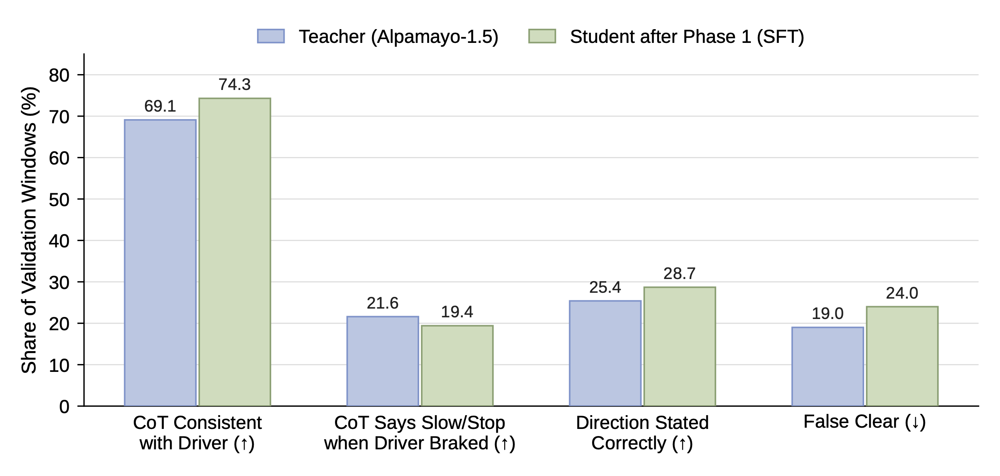
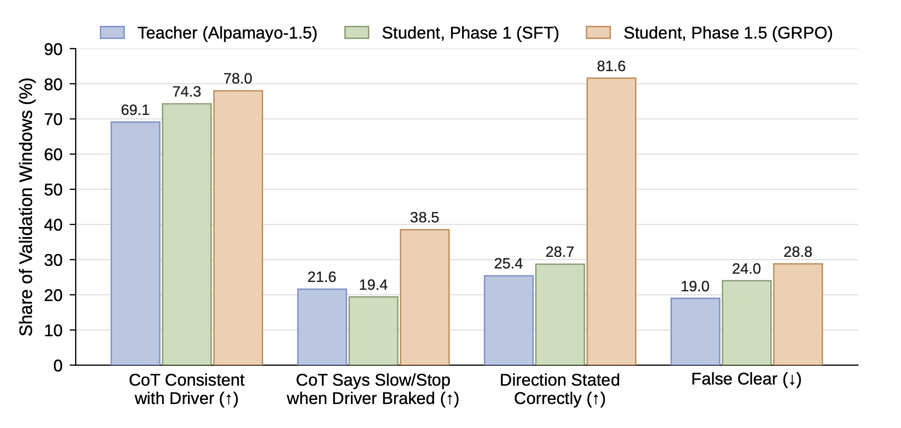
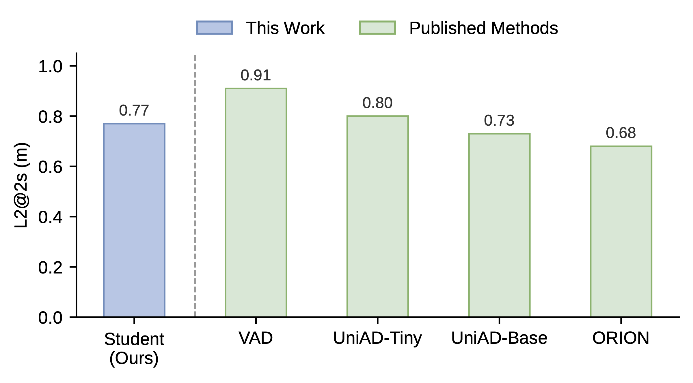

# alpamayostudent
Distilling the reasoning capabilities of NVIDIA's Alpamayo-1.5 into Cosmos 3 Edge, to achieve a student model more suitable for deployment on an edge device.

## Setup

The teacher and the student need different torch versions, so there are two environments: one for labelling with the teacher, and one for training and evaluating the student. Each file lists its install steps at the top.

- `requirements-label.txt`: Python 3.12, torch 2.8, for generating the labelled cache
- `requirements-train.txt`: Python 3.13, torch 2.10, for phases 1, 1.5 and 2 and evaluation

## Generating the labelled cache from PhysicalAI-AV

Curates clips from NVIDIA's PhysicalAI-AV dataset and labels them with the Alpamayo 1.5 teacher, producing the cache that phase 1 and phase 1.5 train on.

```bash
cp configs/paths.example.yaml configs/paths.yaml   # set your own paths
export HF_TOKEN=...                                # needs access to the gated NVIDIA repos
python scripts/download_models.py                  # teacher + student weights
bash scripts/prepare_phase1_data.sh                # 5,000 clips (or a smaller set, e.g. 500)
```

## Phase 1: supervised distillation of the reasoning tower

Trains LoRA adapters (rank 48) on the Cosmos 3 Edge reasoning tower to produce the teacher's output format, a chain-of-thought sentence followed by 128 trajectory tokens, using the labelled cache above.

```bash
bash scripts/train_phase1.sh                                    # full run
bash scripts/train_phase1.sh --micro-batch 2 --grad-accum 16    # for GPUs with less than ~60 GiB
```

The student weights and cache are read from `configs/paths.yaml`; the best checkpoint is written to `<runs_root>/stage1/best`.

The loss combines cross-entropy on the teacher's chain-of-thought, cross-entropy on the structural tokens that delimit it from the trajectory, and a soft cross-entropy of the trajectory tokens against the driver's ground truth:

```math
\mathcal{L}_1 = \mathcal{L}_{\text{cot}} + \lambda_{\text{str}}\,\mathcal{L}_{\text{str}} + \mathcal{L}_{\text{traj}}, \qquad \lambda_{\text{str}} = 0.5
```

To evaluate, the student generates a chain-of-thought for every validation window, and both its and the teacher's are scored against the driver's recorded future. This prints the metrics shown in the chart below:

```bash
bash scripts/eval_cot.sh phase1                                 # <runs_root>/stage1/best
bash scripts/eval_cot.sh phase1 --ckpt /path/to/checkpoint      # any other phase 1 checkpoint
```



**What we tried.** We started with classic distillation: a KL term on the teacher's trajectory logits and a feature-matching term on its cached hidden states. The feature term contributed about 1% of the loss with no measurable effect, and the KL term transferred little because the teacher's own trajectories only reach 3.77 m minADE. So the trajectory is now supervised by the driver's ground truth, and the teacher is used only for its language. Comparing the teacher's chain-of-thought with the driver's actual future showed that it contradicts the driver in about 18% of windows, since it was labelled without a route. We filter those windows out and give the student a direction-only route hint. The student also learned to continue its trajectory prefix without looking at the frames, which random jitter and masking of the prefix removed. A single-camera student and maneuver-balanced sampling both left the chain-of-thought collapsed onto "follow the lane", so we kept four cameras and uniform sampling. Since phase 2 produces the final trajectory, checkpoints are selected on how often the chain-of-thought agrees with the driver, not on trajectory error.

## Phase 1.5: GRPO on the chain-of-thought

Starts from the phase 1 checkpoint and trains a fresh rank-48 LoRA with GRPO, so that the chain-of-thought agrees with what the driver actually did.

```bash
bash scripts/train_phase1_5.sh                                  # starts from <runs_root>/stage1/best
bash scripts/train_phase1_5.sh --init-ckpt /path/to/phase1/best # starts from another phase 1 checkpoint
```

Paths are read from `configs/paths.yaml`; checkpoints are written to `<runs_root>/stage1_rl/grpo-coc/`, with the adapters from every evaluation in `step-NNNN/` and the best one in `best/`.

For each training window the policy samples a group of $`G = 16`$ chains-of-thought. Each candidate's advantage is its reward relative to the group:

```math
A_g = \frac{r_g - \mu_G}{\sigma_G}
```

The reward checks each claim against the driver's recorded 6.4 s future. $`r_{\text{kin}}, r_{\text{dir}} \in \{0, 1\}`$ are whether the speed claim (stop, slow down, keep speed) and the direction claim (turn left or right) match the driver. $`p_{\text{hold}} = 1`$ if the CoT claims a speed change while the driver held speed, and $`p_{\text{nudge}} = 1`$ if it falls back on an unverifiable hedge:

```math
r_g = r_{\text{kin}} + 0.5\,r_{\text{dir}} - 0.5\,p_{\text{hold}} - 0.25\,p_{\text{nudge}}
```

Updates use a clipped probability ratio and a KL penalty toward the phase 1 policy. Rollouts generate only the chain-of-thought, not the trajectory.

To evaluate, the same scoring as phase 1 is run on the full validation set, either for the best checkpoint or for the adapters saved at one evaluation step:

```bash
bash scripts/eval_cot.sh phase1_5                               # <runs_root>/stage1_rl/grpo-coc/best
bash scripts/eval_cot.sh phase1_5 --step 25                     # adapters from step 25 on the phase 1 checkpoint
```



**What we tried.** We first rewarded agreement with the teacher's chain-of-thought, which only copied its route-blindness. We then rewarded the chain-of-thought through the trajectory it leads to, as NVIDIA does for the teacher, but this failed because the phase 1 trajectory barely depends on the chain-of-thought: forcing "turn left" instead of "turn right" moved the planned heading by only a few degrees. Only a reward that scores the words directly against the driver's log moved the reasoning. That reward had to be strict, because whenever a claim could not score below zero the policy collapsed onto it. Without the hold-speed penalty, 49% of hold-speed windows were answered with "slow down", and hedges like "nudge" needed their own penalty for the same reason. The in-loop reward also proved unreliable for picking checkpoints, so they are compared on the full 1,046-window validation set.

## Phase 2: flow-matching action head on Bench2Drive

Trains the student's generation tower as a flow-matching action head that turns the reasoning context into a 6.4 s trajectory. The head reads the reasoning tower's keys and values, which carry the front camera frames, the ego history, the route command and the chain-of-thought, and denoises 64 future action tokens. It also receives the next route waypoint (4–6 m ahead) and the next route keypoint (up to 50 m ahead) as two extra tokens, whose projection starts at zero. Training uses the Bench2Drive training split, with each window's chain-of-thought generated offline by the phase 1.5 model. The generation tower is fully fine-tuned, and the reasoning tower gets a rank-48 LoRA trained by the flow-matching loss.

<!-- TODO: commands for Bench2Drive preparation, the chain-of-thought cache, training and evaluation -->

With $`a_1 \in \mathbb{R}^{64 \times 2}`$ the expert's actions, $`a_0`$ Gaussian noise, and the flow time drawn as $`t = 0.999\,(1 - u)`$ with $`u \sim \mathrm{Beta}(1.5, 1)`$, the head $`v_\theta`$ predicts the velocity at $`a_t = t\,a_1 + (1 - t)\,a_0`$ given the reasoning context $`c`$. Each action step is weighted by $`w_m = 1`$ for the first 3 s and $`w_m = 0.1`$ after, with $`\omega = \sum_m w_m`$:

```math
\mathcal{L}_{\text{fm}} = \mathbb{E}_{t, a_0}\left[\frac{1}{\omega} \sum_{m=1}^{64} w_m \left\lVert v_{\theta,m}(a_t, t \mid c) - (a_{1,m} - a_{0,m}) \right\rVert_2^2\right]
```

Two auxiliary terms are added: $`\mathcal{L}_{\text{ade}}`$, the displacement error in metres of the trajectory integrated from the predicted velocity (same step weights, weighted toward low-noise flow times), and $`\mathcal{L}_{\text{cot}}`$, cross-entropy of the reasoning tower on the cached chain-of-thought:

```math
\mathcal{L}_2 = \mathcal{L}_{\text{fm}} + \lambda_{\text{ade}}\,\mathcal{L}_{\text{ade}} + \lambda_{\text{cot}}\,\mathcal{L}_{\text{cot}}, \qquad \lambda_{\text{ade}} = \lambda_{\text{cot}} = 1.0
```



**What we tried.** The released Cosmos 3 Edge model cannot generate actions on their own, because its sampler denoises video and action tokens together, so we implemented an action-only forward pass through the generation tower, with an input projection for noisy actions and a time embedding. Earlier runs trained the head on top of a frozen reasoning tower and showed that it does not read the chain-of-thought text, so we added the LoRA on the reasoning tower to let driving decisions flow through its hidden states. That LoRA started to degrade the reasoning: the share of chains-of-thought that terminated properly fell from 1.00 to 0.73, which the $`\mathcal{L}_{\text{cot}}`$ term prevents. The step weights follow from the metric: Bench2Drive's L2 and the vehicle's controller only read the first 3 s of the plan, while most of the error builds up after it. The Beta time sampler, taken from the teacher's recipe, puts more training at the high-noise end, where the sampler decides whether to stop or move. Using only the front camera reduces the number of vision tokens.
